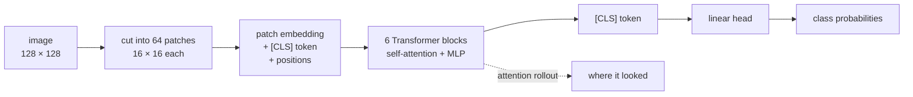
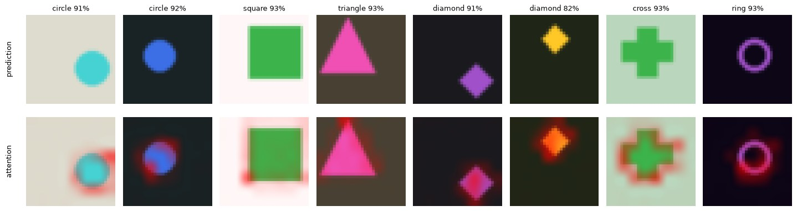
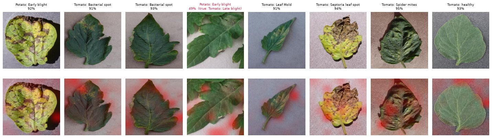

<div align="center">
  
  <h1>Tiny-ViT: a Vision Transformer from scratch</h1>
  <p><b>Show it an image, it tells you what is in it, and where it looked.</b></p>
</div>

[](pyproject.toml)
[](https://pytorch.org)
[](docs/testing.md)
[](app/streamlit_app.py)

A complete Vision Transformer (ViT) image classifier written from scratch in
plain PyTorch: patch embedding, multi-head self-attention, pre-norm Transformer
blocks and a classification head, in one ~270-line file meant to be read top
to bottom. It comes with a training CLI (CPU, one GPU, several GPUs or
machines), evaluation, a Streamlit web demo with attention heatmaps, a
Kaggle / Colab notebook, and a test suite that checks the maths, not just the
shapes. It was built to recognise **tomato and potato leaf diseases**
(PlantVillage) and works on any folder of labelled images.



> **No trained weights are published.** Train a model first (steps 3–5 below,
> or the [Kaggle/Colab notebook](notebooks/train_colab_kaggle.ipynb)); a
> checkpoint is then saved in `checkpoints/`.

## Quick start

```bash
# 1. install (Python >= 3.10)
python -m venv .venv
source .venv/bin/activate
pip install -e '.[dev]'          # see docs/training.md for a CPU-only torch

# 2. unit tests and neural-network sanity checks (CPU, offline, a few minutes)
pytest

# 3. sanity check: can the model memorise 32 images? (validation accuracy must hit 100%)
vit-train --dataset shapes --overfit 32 --epochs 200 --lr 1e-3 --warmup-steps 10 \
          --log-every 10 --output-dir checkpoints/overfit

# 4. prove it learns from pixels: synthetic shapes, no download, laptop CPU
vit-train --dataset shapes --epochs 15 --lr 1e-3 --warmup-steps 200 --output-dir checkpoints/shapes

# 5. the real task: PlantVillage tomato / potato leaves (download: docs/datasets.md)
vit-train --dataset folder --data-dir data/plantvillage_hf/color --augment strong \
          --epochs 60 --batch-size 128 --lr 1e-3 --output-dir checkpoints/plantvillage

# 6. use the trained model
vit-predict  --checkpoint checkpoints/shapes/best.pt --image my_image.png
vit-evaluate --checkpoint checkpoints/shapes/best.pt --split test
streamlit run app/streamlit_app.py -- --checkpoint checkpoints/shapes/best.pt
```

## Results

Everything below was run on a laptop CPU (no GPU, shared with other jobs);
the exact commands are in [docs/testing.md](docs/testing.md#2-real-training-runs).

**Synthetic shapes, trained from scratch: 97.3 % on 1 200 unseen test images.**
A 0.81 M-parameter ViT (32 px images, 4 px patches, 4 layers) trained for 15
epochs (about 80 min wall-clock on a CPU shared with other jobs). The class depends only on the shape, never on
colour, size or position, so the model must read the pixels. Most errors are
a cross or a diamond called a circle.



*Top: unseen test images with the model's prediction. Bottom: attention
rollout, where the [CLS] token looked: the edges and corners that define each
shape (the triangle's apex, the square's corners, the ring's outline).
Confidence tops out around 92 % because label smoothing 0.1 trains towards
0.917 for 6 classes.*

| class | circle | square | triangle | diamond | cross | ring |
|---|---:|---:|---:|---:|---:|---:|
| recall | 98.5 % | 99.0 % | 100 % | 96.0 % | 93.0 % | 97.5 % |
| precision | 91.2 % | 99.5 % | 100 % | 99.0 % | 97.9 % | 97.0 % |

**PlantVillage, 12 tomato / potato classes, trained from scratch: 85.9 % on
1 495 unseen test leaves.** A deliberately small model so it trains on a
CPU: 0.83 M parameters, 64 px images, 8 px patches, 4 layers, 12 epochs
(~65 min). Validation accuracy was still rising when it stopped; the
full-size configuration (128 px, 6 layers, 60 epochs, strong augmentation) is
a GPU job for the [notebook](notebooks/train_colab_kaggle.ipynb).



*Test leaves the model never saw (top) and its attention rollout (bottom).
Honest caveat: the attention often lands on the **background** around the
leaf rather than on the lesions. PlantVillage photos of each class were taken
in their own lab sessions, so backgrounds correlate with labels, a known
shortcut of this dataset. Part of the accuracy may come from it, which is
why field photos (PlantDoc) are in the next steps.*

Strongest classes: tomato bacterial spot (95 % recall), tomato healthy (95 %),
spider mites (93 %). Weakest: potato healthy (67 %, only 152 images in the
whole dataset) and tomato early blight (70 %, confused with leaf mold and
late blight). Full per-class table and confusion matrix:
[docs/testing.md](docs/testing.md#2-real-training-runs); real test examples:
[docs/examples/plantvillage](docs/examples/plantvillage/README.md).

Also verified: **86 tests (96 % line coverage)**, including the standard
neural-network sanity checks (initial loss = ln C, gradient check, every
parameter learns, no leakage between samples, dropout off in eval, deep
stacks stay well scaled, overfits a batch, bit-for-bit resume, gradient
accumulation = big batch, 2-process DDP stays in sync); the notebook runs end
to end; the Streamlit page is tested with Streamlit's `AppTest`.

## Datasets

| `--dataset` | Images | Download | Use it to |
|---|---|---|---|
| `shapes` | 12 000 generated, 6 shapes in random colours / sizes / positions | none | prove the model reads the image (laptop CPU) |
| `cifar10` | 60 000 photos, 32 × 32, 10 classes | 170 MB, automatic | the standard small benchmark |
| `folder` | any `data_dir/<class>/<images>`, e.g. PlantVillage (12 tomato / potato classes, ~15 000 photos) | you provide it | real tasks |

Details, the PlantVillage download command and how splits are made:
[docs/datasets.md](docs/datasets.md).

## What changed from the first version

The first version (kept in [`legacy/`](legacy/README.md)) could not run as
published. All of these are fixed and covered by tests:

| Problem in v1 | Effect | Now |
|---|---|---|
| `train.py` called `VisionTransformer(config)` but the model takes keyword arguments; imports worked from no single folder | training crashed immediately | one installable package, `vit-train` command, tested end to end |
| attention did `self.training = training` (default `True`) | **dropout stayed on in evaluation** and in the app | PyTorch's own train / eval mode (tested) |
| 24 000 epochs, gradient clipping at 0.05 | the schedule never finished; tiny fixed-size steps | per-step warmup + cosine, clip at 1.0 |
| MLP width hard-coded to 4 × width while the config said 6 × | saved checkpoints described the wrong architecture | the configured width is used |
| app loaded `C:\Users\Omar\...\vit_chpts.pth`, assumed 256 px images (training used 128) | ran on one PC only, with the wrong input size | `--checkpoint` flag; image size, normalisation and class names come from the checkpoint |
| unseeded splits, `os.listdir()[:N]` subsets | a different test set every run | stratified split from a fixed seed |

The full audit (model, training, data, app) is in [legacy/README.md](legacy/README.md).

## Documentation

| Guide | What is inside |
|-------|----------------|
| [notebooks/train_colab_kaggle.ipynb](notebooks/train_colab_kaggle.ipynb) | **Train on a free Kaggle or Colab GPU**: self-contained, shapes / CIFAR-10 / PlantVillage, live loss and accuracy dashboard |
| [docs/architecture.md](docs/architecture.md) | How the ViT works, step by step, with tensor shapes, init and parameter count |
| [docs/datasets.md](docs/datasets.md) | The three data sources, PlantVillage download, splits, your own images |
| [docs/training.md](docs/training.md) | Sanity checks, CPU / GPU / multi-GPU / multi-node, resume, the important flags |
| [docs/inference.md](docs/inference.md) | Predict (CLI, Python), the Streamlit app, evaluation on the test split |
| [docs/testing.md](docs/testing.md) | What each test proves, and the real training runs |
| [legacy/README.md](legacy/README.md) | What was wrong with the first version |

## Repository layout

```
src/tiny_vit/          the package (read in this order)
  config.py            every hyperparameter: DataConfig, ModelConfig, TrainConfig, presets
  data.py              shapes / CIFAR-10 / image-folder datasets, stratified splits, transforms
  model.py             the Vision Transformer, from patches to logits, + attention rollout
  train.py             training loop: AMP, grad accumulation, DDP, checkpoints, resume, CLI
  predict.py           Predictor: checkpoint + images -> classes, attention heatmaps; CLI
  evaluate.py          test-split accuracy, per-class recall / precision, confusion matrix
app/streamlit_app.py   web demo: upload an image, see the class and the attention map
notebooks/             Kaggle / Colab notebook (+ the script that builds it from src/)
tests/                 pytest suite (CPU only, offline)
docs/                  guides
legacy/                the original code, kept for reference, with an audit of its issues
pyproject.toml         dependencies and the vit-train / vit-predict / vit-evaluate commands
```

## Next steps

- [ ] A full GPU run on PlantVillage (all 38 classes) and CIFAR-10, with the
      test scores in this README
- [ ] Pretrained weights to download, so the app works out of the box
- [ ] Field photos (PlantDoc) to measure how well a PlantVillage model transfers
      outside the lab

## Contributors

The first version was built within the pests and vegetable diseases detection
team of [Moroccan Data Scientists (MDS)](https://www.linkedin.com/company/moroccands):

- **Asmae El-Ghezzaz** ([GitHub](https://github.com/aelghezzaz)): machine learning and data science methodology
- **Idriss El Houari** ([GitHub](https://github.com/idrisselhouari), [Kaggle](https://www.kaggle.com/idrisselhouari)): curated the plant disease dataset and the initial analysis notebook
- **Farheen Akhter** ([GitHub](https://github.com/FarheenAkhter786), [Kaggle](https://www.kaggle.com/feenuakhter)): crop yield and pest / disease detection analytics, data from local farms in Ghana
- **Aicha Dessa** ([GitHub](https://github.com/aichadessa06), [Kaggle](https://www.kaggle.com/aichadessa)): plant disease data analysis, model training and testing
- **Zeroual Salma** ([GitHub](https://github.com/salmazl)): plant pathology, Botrytis disease insights
- **El Fakir Chaimae** ([GitHub](https://github.com/chaimaeelfakir)): pathogen detection datasets
- **Laghbissi Salma** ([GitHub](https://github.com/salma-laghbissi)): plant pathology research and dataset processing

## Author

**Ismail Ben Alla** ([GitHub](https://github.com/benisalla),
[LinkedIn](https://linkedin.com/in/ismail-ben-alla-7144b5221/),
[X](https://twitter.com/ismail_ben_alla)). Special thanks to Asmae El-Ghezzaz
for her help and advice, and for the invitation to MDS where this project
started.

## License and citation

There is no formal license yet: please credit the source if you use or adapt
the code.

```bibtex
@misc{tiny_vit_2024,
  title  = {TINY-ViT: Vision Transformer from Scratch},
  author = {Ben Alla, Ismail},
  year   = {2024},
  url    = {https://github.com/benisalla/Tiny-ViT-Transformer-from-scratch}
}
```
