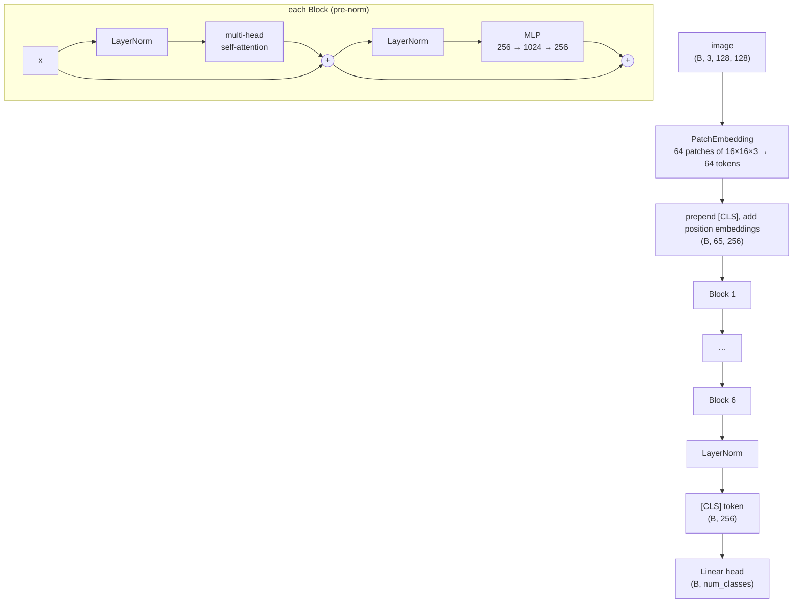

# Architecture

Everything is in [`src/vit_classifier/model.py`](../src/vit_classifier/model.py) (~270
lines, meant to be read top to bottom). This page follows one batch through
the model with the default PlantVillage sizes: 128 × 128 images, 16 × 16
patches, width `D = 256`, 6 layers, 8 heads.



## 1. Patches become tokens

A Transformer works on a sequence of vectors. A ViT makes that sequence by
cutting the image into a grid of square patches, flattening each patch
(`16 × 16 × 3 = 768` numbers) and projecting it to `D` numbers:

| step | shape |
|---|---|
| input | `(B, 3, 128, 128)` |
| `patchify`: 8 × 8 grid of patches, each flattened | `(B, 64, 768)` |
| `LayerNorm → Linear(768, 256) → LayerNorm` | `(B, 64, 256)` |

`--patch-embed conv` does the same with one `Conv2d(3, 256, kernel_size=16,
stride=16)`: with stride = kernel, each output position sees exactly one patch,
so it is the same linear map in one fused op.
`test_conv_and_linear_patch_embeddings_compute_the_same_map` copies the conv
weights into a `Linear` and checks the outputs match. The `linear` variant
(the first version's default) adds two LayerNorms, which helps a little when
training from scratch.

## 2. [CLS] token and position embeddings

- **[CLS]**: one learned vector prepended to the sequence: `(B, 65, 256)`. It
  holds no image content; through attention it collects a summary of the
  image, and the classifier reads only it. (`--pool mean` averages the patch
  tokens instead.)
- **Position embeddings**: attention treats its input as a *set*, so without
  them the model could not tell the top-left patch from the bottom-right one.
  One learned vector per position (65 of them) is added to the tokens.
  `test_position_embeddings_make_patch_order_matter` checks that swapping the
  top and bottom halves of an image changes the output.

## 3. Multi-head self-attention

For each head `h` (8 heads of width `256 / 8 = 32`):

```
Q, K, V = x W_q, x W_k, x W_v                 (B, 8, 65, 32) each, one fused Linear(256, 768)
weights = softmax(Q Kᵀ / √32)                 (B, 8, 65, 65): token i's attention over all j
out     = weights V                           (B, 8, 65, 32)
concat heads → Linear(256, 256)               (B, 65, 256)
```

There is **no causal mask**: unlike text, an image has no "future", every
patch may look at every other one. Training uses PyTorch's fused
`scaled_dot_product_attention` (FlashAttention / memory-efficient kernels on
GPU). `return_attention=True` switches to the explicit formula above so the
weights can be returned for visualisation; the two paths give the same output
(`test_explicit_attention_equals_the_fused_kernel`).

## 4. Pre-norm blocks

```
x = x + Attention(LayerNorm(x))   # tokens exchange information
x = x + MLP(LayerNorm(x))         # each token is transformed on its own
```

The MLP is `Linear(256, 1024) → GELU → Linear(1024, 256)` (`mlp_ratio = 4`).
Normalising *before* each branch (pre-norm) keeps an un-normalised residual
path from input to output, which makes deep stacks train stably without a
long warmup. A final LayerNorm runs before the head.

## 5. Initialisation

| parameter | init | why |
|---|---|---|
| Linear / Conv weights | truncated normal, std 0.02 | the usual ViT / GPT-2 choice |
| last layer of each residual branch (`out_proj`, `fc2`) | std `0.02 / √(2 · n_layers)` | each block adds to the residual stream; this keeps its scale constant with depth (`test_residual_stream_stays_well_scaled_through_depth`) |
| [CLS], position embeddings | std 0.02 | same scale as the patch tokens |
| classification head | **zeros** | every class starts equally likely: the first loss is exactly `ln(num_classes)`, a free check that data and labels are wired correctly |

## 6. Loss and optimisation

Cross-entropy with label smoothing 0.1 (the target puts 0.9 on the right class
and spreads 0.1 over all classes), which discourages over-confident
predictions. AdamW with weight decay 0.05 on weight matrices only (not on
biases, LayerNorms, [CLS] or position embeddings), a linear warmup then cosine
decay of the learning rate, and gradient clipping at norm 1.0.

ViTs have **no built-in image prior** (a CNN's convolutions assume nearby
pixels matter together; a ViT must learn it). On small datasets they therefore
need strong augmentation and regularisation; `--augment strong` adds vertical
flips, TrivialAugment and random erasing.

## 7. Attention rollout (what the app shows)

`attention_rollout()` estimates which patches the [CLS] token relied on,
through all layers (Abnar & Zuidema, 2020): average each layer's heads, add the
identity matrix for the residual connection, renormalise the rows, and
multiply the layers together. The [CLS] row of the product, reshaped to the
8 × 8 patch grid, is the heatmap overlaid on the image. It is an
approximation (it ignores the MLPs and the value vectors), good for a quick
look at what the model attends to.

## 8. Parameter count

For one block: attention `4·D² + 4·D`, MLP `8·D² + 5·D`, two LayerNorms `4·D`.
Default sizes (`D = 256`, 6 blocks, 12 classes, linear patch embedding):

| part | parameters |
|---|---|
| patch embedding (768 → 256, two LayerNorms) | 198 k |
| [CLS] + 65 position embeddings | 17 k |
| 6 blocks × 790 k | 4.74 M |
| final LayerNorm + head | 4 k |
| **total** | **4.96 M** |
