| image | prediction | confidence | truth | correct |
|:---:|---|---:|---|:---:|
| 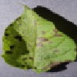 | Potato___Early_blight | 91% | Potato___Early_blight | yes |
| 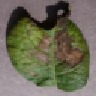 | Potato___Late_blight | 72% | Potato___Late_blight | yes |
| 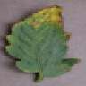 | Tomato___Bacterial_spot | 91% | Tomato___Bacterial_spot | yes |
| 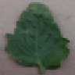 | Tomato___Bacterial_spot | 92% | Tomato___Bacterial_spot | yes |
| 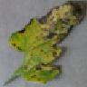 | Tomato___Early_blight | 50% | Tomato___Early_blight | yes |
| 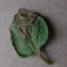 | Tomato___Early_blight | 41% | Tomato___Late_blight | **no** |
| 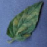 | Tomato___Leaf_Mold | 96% | Tomato___Leaf_Mold | yes |
| 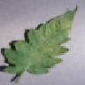 | Tomato___Septoria_leaf_spot | 90% | Tomato___Septoria_leaf_spot | yes |
| 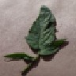 | Tomato___Spider_mites Two-spotted_spider_mite | 66% | Tomato___Spider_mites Two-spotted_spider_mite | yes |
|  | Tomato___Spider_mites Two-spotted_spider_mite | 92% | Tomato___Spider_mites Two-spotted_spider_mite | yes |
| 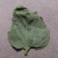 | Tomato___Target_Spot | 87% | Tomato___Target_Spot | yes |
| 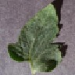 | Tomato___Spider_mites Two-spotted_spider_mite | 54% | Tomato___healthy | **no** |
